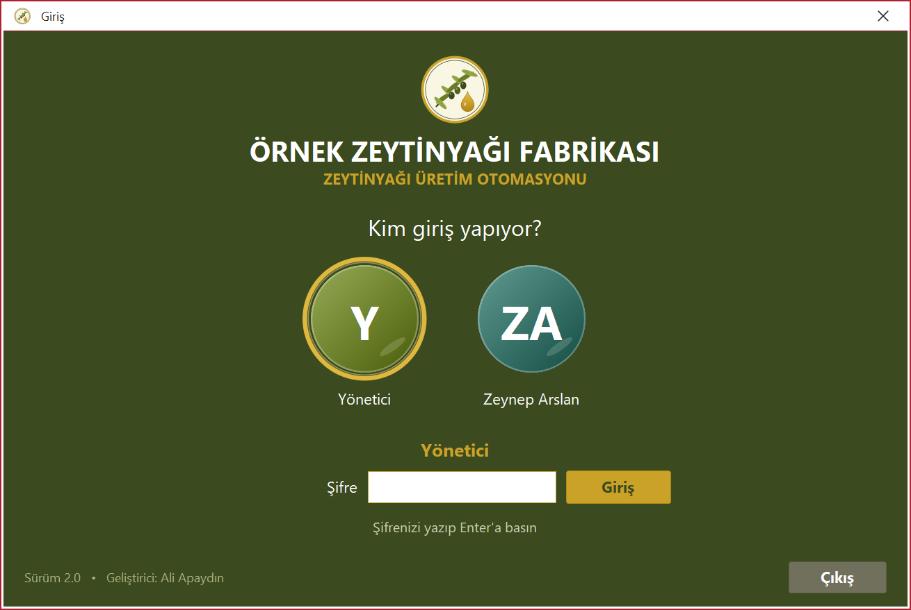
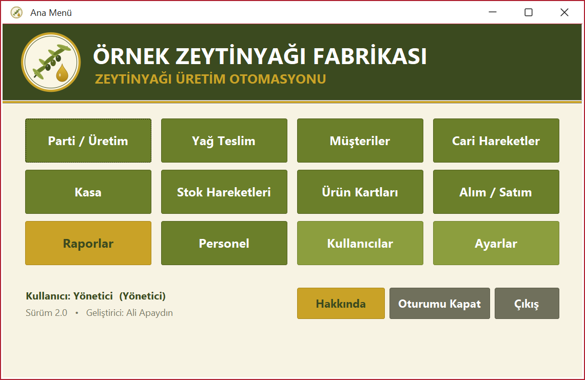
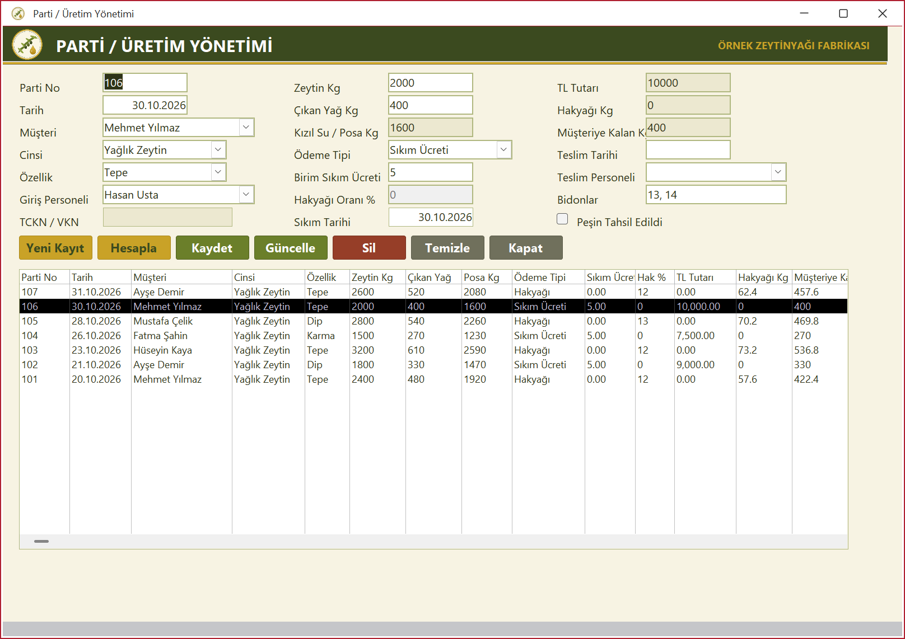
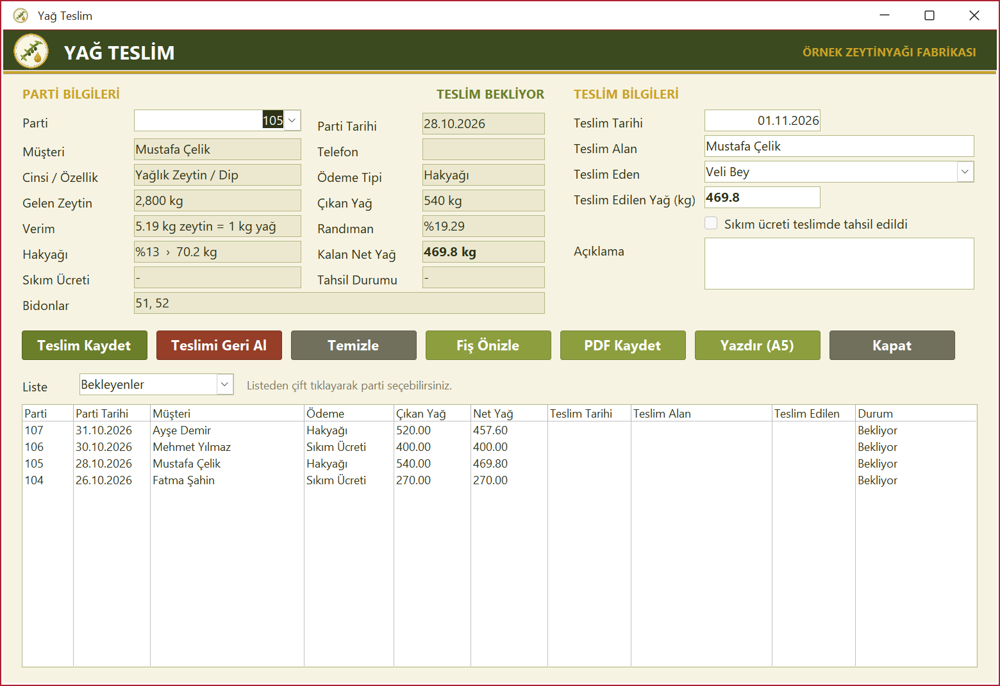
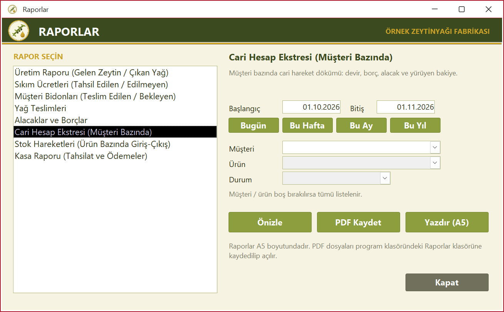
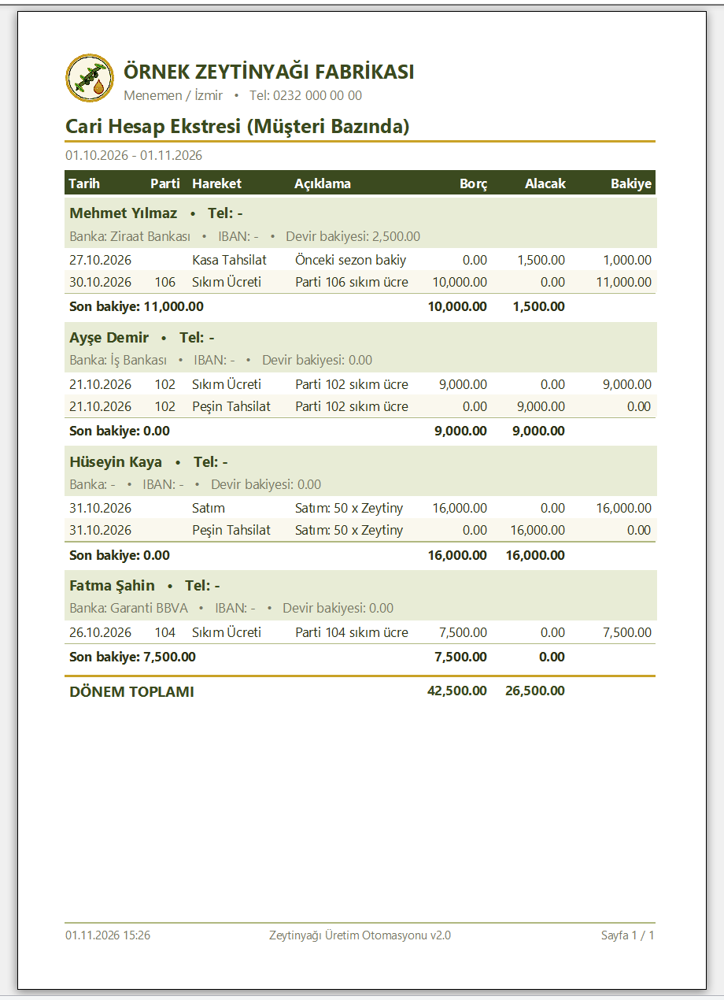

<p align="center">
  
</p>

<h1 align="center">Zeytinyağı Üretim Otomasyonu</h1>

<p align="center">
  Zeytinyağı fabrikaları için <b>parti / üretim, hakyağı, yağ teslimi, cari, kasa, stok ve raporlama</b> programı.<br>
  Microsoft Access (VBA) ile yazılmıştır; kurulum gerektirmez, tek dosyadan çalışır.
</p>

<p align="center">
  
  
  
</p>

---

## Ekran görüntüleri

| Giriş | Ana menü |
|---|---|
|  |  |
| **Parti / Üretim** | **Yağ Teslim** |
|  |  |
| **Raporlar** | **A5 rapor çıktısı** |
|  |  |

## Özellikler

**Parti / Üretim**
- Parti numarası elle verilir; müşteri, cins, özellik, giriş personeli, zeytin ve çıkan yağ miktarı girilir.
- Ödeme tipi **Sıkım Ücreti** ise TL tutarı = zeytin kg × birim ücret; **Hakyağı** ise hakyağı = çıkan yağ × oran %.
- Kızıl su / posa, müşteriye kalan yağ otomatik hesaplanır.
- Kaydedince cari, kasa ve stok kayıtları otomatik oluşur. Hakyağından ücretliye (veya tersi) geçişte eski kayıtlar silinip yenileri yazılır.

**Yağ Teslim**
- Teslim tarihi, teslim alan, teslim eden personel, teslim edilen yağ miktarı.
- Parti özeti: gelen zeytin, çıkan yağ, **verim** (kaç kg zeytinden 1 kg yağ), randıman %, hakyağı, kalan net yağ veya sıkım ücreti.
- Ücret teslimde alındıysa tek tıkla kasaya ve cariye tahsilat olarak işlenir.
- **A5 teslim fişi**: önizleme, PDF veya yazıcı (teslim eden / teslim alan imza alanlarıyla).

**Cari, Kasa, Stok**
- Müşteri kartı: TCKN/VKN, telefon, adres, banka, IBAN, açılış bakiyesi.
- Cari hareketlerde borç / alacak / **yürüyen bakiye**, müşterinin bidonları.
- Kasa: tahsilat / ödeme, iki tarih arası süzme, devir ve bakiye.
- Stok: ürün bazında giriş / çıkış / kalan; hakyağı stoğu otomatik.

**Raporlar (A5 — önizleme, PDF, yazıcı)**

| Rapor | İçerik |
|---|---|
| Üretim Raporu | Tarih aralığında gelen zeytin, çıkan yağ, randıman, hakyağı, ücretler |
| Sıkım Ücretleri | Tahsil edilen / edilmeyen ücretler, ara toplamlar |
| Müşteri Bidonları | Müşteri bazında teslim edilen / bekleyen bidonlar |
| Yağ Teslimleri | Teslim alan, teslim eden, miktarlar |
| Alacaklar ve Borçlar | Seçilen tarih itibarıyla cari bakiyeler |
| Cari Hesap Ekstresi | Müşteri bazında devir, borç, alacak, yürüyen bakiye |
| Stok Hareketleri | Ürün bazında devir, giriş, çıkış, kalan |
| Kasa Raporu | Devir, tahsilat, ödeme, yürüyen bakiye |

**Kullanıcılar ve güvenlik**
- Netflix tarzı **profil kartlarıyla giriş**: profil seçilir, şifre yazılır.
- **Yönetici (admin)** kullanıcı ekler, siler, şifrelerini belirler; diğer kullanıcılar yalnızca giriş yapar.
- Şifreler tabloda açık yazılmaz, tuzlu özet olarak saklanır.

**Firma ayarları**
- Firma adı, adresi ve telefonu **Ayarlar** ekranından girilir; tüm başlıklarda ve raporlarda bu ad görünür.
- Varsayılan sıkım ücreti ve hakyağı oranı yeni partiye otomatik gelir.

## Kurulum

1. Bu depoyu indirin (**Code → Download ZIP**) ve bir klasöre çıkarın.
2. `ApaydinOtomasyon.accdb` dosyasını Microsoft Access (2016 / 2019 / 2021 / 365) ile açın.
3. Üstte sarı güvenlik çubuğu çıkarsa **İçeriği Etkinleştir**'e basın.
   Kalıcı çözüm: *Dosya → Seçenekler → Güven Merkezi → Güven Merkezi Ayarları → Güvenilen Konumlar → Yeni konum ekle* ile klasörü ekleyin.
4. `Gorseller` klasörü veritabanıyla aynı klasörde durmalıdır (program simgesi buradan okunur).

### İlk giriş

| Kullanıcı | Şifre |
|---|---|
| **Yönetici** (admin) | `1234` |
| Zeynep Arslan (örnek kullanıcı) | `1234` |

> İlk girişten sonra **Ayarlar → Yönetici Şifresi** bölümünden admin şifresini değiştirin,
> **Ayarlar → Firma Bilgileri**'nden kendi firma adınızı girin ve örnek kullanıcıyı silin.

Depodaki veritabanında **tamamen uydurma örnek veriler** vardır. Kendi kullanımınız için örnek müşteri ve partileri silebilirsiniz.

## Kullanım

- **Ana menü** → modüller: Parti / Üretim, Yağ Teslim, Müşteriler, Cari Hareketler, Kasa, Stok Hareketleri, Ürün Kartları, Alım / Satım, Raporlar, Personel; yöneticiye ek olarak Kullanıcılar ve Ayarlar.
- Her formda aynı düğmeler: **Yeni Kayıt, Kaydet, Güncelle, Sil, Temizle, Kapat**. Kayıtlı bir kaydı değiştirmek için listede çift tıklayıp **Güncelle**'ye basın.
- Raporlarda tarih aralığı seçin (Bugün / Bu Hafta / Bu Ay / Bu Yıl kısayolları), gerekirse müşteri / ürün / durum süzün; **Önizle**, **PDF Kaydet** veya **Yazdır (A5)**.
  PDF dosyaları program klasöründeki `Raporlar` klasörüne kaydedilir.

## Geliştirme

- Veritabanını açarken **Shift** tuşuna basılı tutarsanız giriş ekranı açılmaz; formlar, raporlar ve VBA kodu düzenlenebilir.
- VBA kodu modüllere bölünmüştür ve her modülün başında Türkçe açıklama vardır. Kaynakların metin kopyaları `kaynak/` klasöründedir:

```
kaynak/
├── vba/         modOrtak, modGiris, modParti, modTeslim, modRapor, modMusteri, modCari, modKasa, modStok, modUrun, modAlimSatim, modPersonel, modHakkinda
├── sorgular/    tüm sorguların SQL metinleri
├── formlar/     form tasarımları (Access SaveAsText)
└── raporlar/    rapor tasarımları (Access SaveAsText)
```

- Hareket tablolarındaki `KaynakTipi / KaynakID / OtomatikMi` alanları, bir kaydın hangi ekrandan otomatik üretildiğini tutar. Otomatik kayıtlar elle değiştirilemez; kaynağı güncellenince yeniden yazılır.

## Yol haritası

- [ ] Bulut yedekleme / çok kullanıcılı bulut veritabanı
- [ ] Banka hesap hareketleri ve banka raporları
- [ ] Toplu SMS / e-posta ile teslim bildirimi

## Geliştirici

**Ali Apaydın**

- E-posta: [apaydin.a@gmail.com](mailto:apaydin.a@gmail.com)
- GitHub: [github.com/sifirgecikme](https://github.com/sifirgecikme)

© 2026 Ali Apaydın. Tüm hakları saklıdır.
