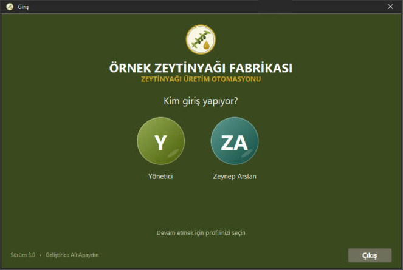
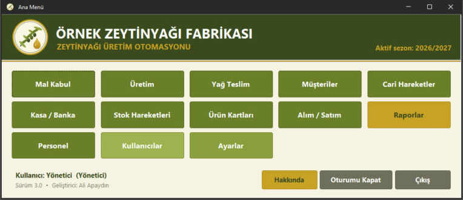
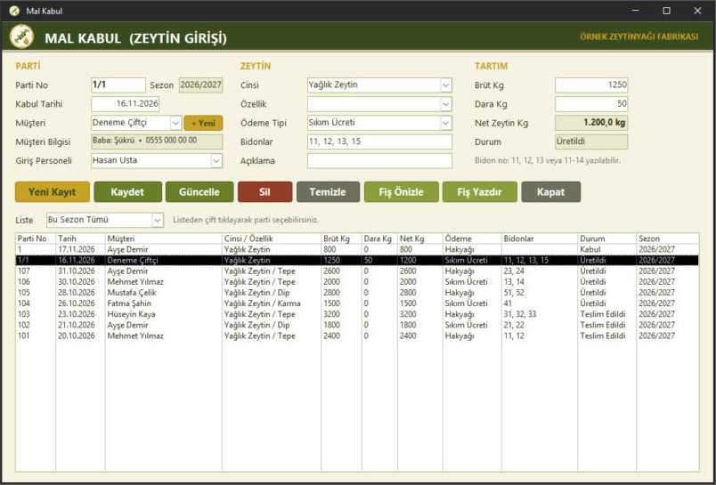
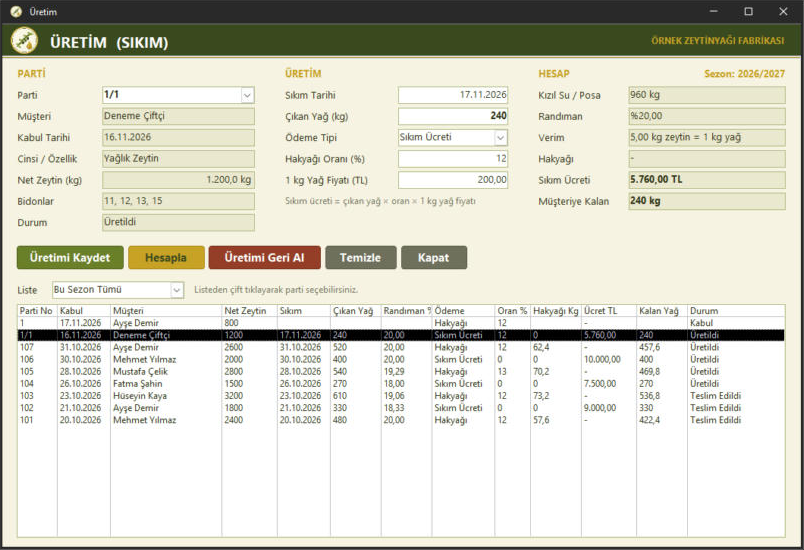
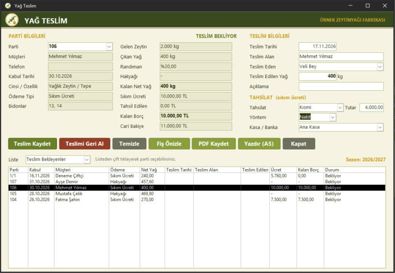
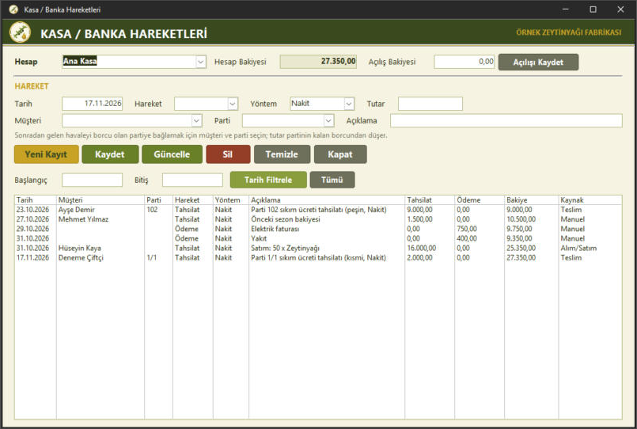
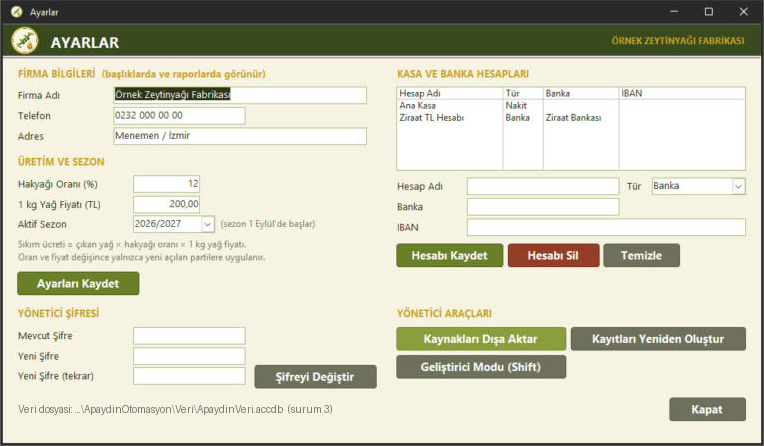

<p align="center">
  
</p>

<h1 align="center">Zeytinyağı Üretim Otomasyonu</h1>

<p align="center">
  Zeytinyağı fabrikaları için <b>mal kabul, üretim, yağ teslimi, sıkım ücreti / hakyağı, cari, kasa-banka, stok ve raporlama</b> programı.<br>
  Microsoft Access (VBA) ile yazılmıştır. Program ve veri ayrı dosyalardır; program güncellenince veriler korunur.
</p>

<p align="center">
  
  
  
</p>

---

## Ekran görüntüleri

| Giriş | Ana menü |
|---|---|
|  |  |
| **Mal Kabul** | **Üretim** |
|  |  |
| **Yağ Teslim** | **Kasa / Banka** |
|  |  |
| **Ayarlar** | |
|  | |

## Sürüm 3.0'da neler değişti

- Eski tek **Parti** ekranı üçe ayrıldı: **Mal Kabul → Üretim → Yağ Teslim**.
- **Sezonlar**: her sezon 1 Eylül'de başlar, aktif sezon Ayarlar'dan seçilir. Listeler ve raporlar sezona göre süzülür.
- **Parti No** sezon içinde otomatik önerilir, elle değiştirilebilir. Teslim edilmiş partinin numarası yeniden kullanılabilir.
- **Sıkım ücreti** artık çıkan yağa göre hesaplanır: `çıkan yağ × hakyağı oranı × 1 kg yağ fiyatı`.
- **Teslimde tahsilat**: peşin veya kısmi; nakit, havale ya da kart; kasa veya banka hesabı seçilir.
- **Banka hesapları** ve partiye bağlanan **havaleler**.
- **Program / veri ayrımı**, kaynaktan kurulum betiği (`araclar\Kur.vbs`), otomatik veri yükseltme.
- Hızlandırılmış ekstre sorguları, satışta stok kontrolü, bidon numarası aralıkları (`11-14 16`), A5 mal kabul fişi.

## Özellikler

**Mal Kabul**
- Parti No (sezon içinde önerilir), tarih, müşteri, cins / özellik, **brüt – dara = net kg**, bidon numaraları, ödeme tipi (Sıkım Ücreti / Hakyağı).
- **+ Yeni** ile ekrandan çıkmadan hızlı müşteri kaydı (ad, baba adı, telefon).
- Bidonlar aralıkla yazılabilir (`11-14 16` → 11, 12, 13, 14, 16). Başka bir partide teslim bekleyen bidon varsa uyarı verilir.
- **A5 Mal Kabul Fişi**: önizleme, PDF veya yazıcı.

**Üretim**
- Sıkım tarihi, çıkan yağ, randıman ve verim (kaç kg zeytinden 1 kg yağ).
- Hakyağı oranı (varsayılan %12) ve 1 kg yağ fiyatı (varsayılan 200 TL) Ayarlar'dan gelir ve partiye kopyalanır. Ayarlar sonradan değişse de eski partiler etkilenmez.
- **Sıkım Ücreti** seçildiyse ücret müşterinin carisine borç olarak yazılır. Örnek: 240 kg × %12 × 200 TL = 5.760 TL.
- **Hakyağı** seçildiyse ücret yazılmaz; `çıkan yağ × oran` kadar yağ fabrikanın stoğuna girer.

**Yağ Teslim**
- Parti özeti: gelen zeytin, çıkan yağ, randıman, hakyağı, kalan net yağ, sıkım ücreti, tahsil edilen, kalan borç, cari bakiye.
- Tahsilat: **Tahsil Edilmedi / Peşin / Kısmi**. Kısmide tutar girilir, kalanı borç olarak durur.
- Yöntem **Nakit / Havale / Kart** ve kasa veya banka hesabı. Tahsilat seçilen hesaba işlenir.
- **Teslimi Geri Al**: parti yeniden teslim bekler. Numara bu arada başka bir partiye verildiyse eski parti `105/1`, `105/2` olarak yeniden adlandırılır.
- **A5 teslim fişi** (teslim eden / teslim alan imza alanlarıyla).

**Cari, Kasa / Banka, Stok**
- Müşteri kartı: TCKN/VKN, ad soyad, **baba adı**, telefon, adres, banka, IBAN, açılış bakiyesi.
- Cari hareketler: borç / alacak / yürüyen bakiye, müşterinin bidonları.
- Kasa ve banka hesapları ayrı bakiyelerle tutulur. Sonradan gelen bir **havale partiye bağlanabilir**; tutar partinin kalan borcundan düşer.
- Stok: ürün bazında giriş / çıkış / kalan. Hakyağı stoğu otomatik oluşur. Satışta stok yetersizse uyarı verilir.

**Raporlar (A5: önizleme, PDF, yazıcı)**

Her raporda sezon seçilebilir; tarih aralığı ve sezon rapor başlığında görünür.

| Rapor | İçerik |
|---|---|
| Üretim Raporu | Gelen zeytin, çıkan yağ, randıman, hakyağı, ücretler |
| Sıkım Ücretleri | Parti bazında yağ, ücret, tahsil edilen, kalan |
| Müşteri Bidonları | Teslim edilen / bekleyen bidonlar |
| Yağ Teslimleri | Teslim alan, teslim eden, miktarlar |
| Alacaklar ve Borçlar | Seçilen tarih itibarıyla cari bakiyeler |
| Cari Hesap Ekstresi | Devir, borç, alacak, yürüyen bakiye |
| Stok Hareketleri | Ürün bazında devir, giriş, çıkış, kalan |
| Kasa Raporu | Hesap bazında devir, tahsilat, ödeme, bakiye |

**Kullanıcılar ve güvenlik**
- Profil kartlarıyla giriş: profil seçilir, şifre yazılır.
- **Yönetici** kullanıcı ekler, siler ve şifre belirler. Ayarlar ekranını yalnızca yönetici açar.
- Şifreler tuzlu özet (hash) olarak saklanır.
- Shift ile tasarım görünümüne geçiş kapalıdır (aşağıdaki *Geliştirici modu* bölümüne bakın).

**Yedekleme**
- **Ayarlar → Yedek Al**: takılı flaş bellekler ve diskler listelenir, istenirse **Klasör Seç** ile başka bir yer seçilir. Veri dosyası seçilen yerde `ApaydinOtomasyon_Yedek` klasörüne `ApaydinVeri_yyyy-aa-gg_ss-dd-nn.accdb` adıyla yazılır. Klasör yoksa oluşturulur; eski yedekler silinmez.
- Yedek, program açıkken de güvenle alınır: dosya önce geçici klasöre kopyalanır, sıkıştırılıp doğrulanır, sonra hedefe yazılır.
- **Ayarlar → Yedekten Geri Yükle** (yalnızca yönetici): takılı flaşlar, diskler, son yedek klasörü ve seçilen klasörler taranır. **En güncel yedek önerilir**, diğerleri ayrı listede görünür. Daha eski bir yedek seçilirse uyarı verilir.
- Geri yüklemede mevcut veri silinmez; bu bilgisayardaki `Yedek` klasörüne taşınır. Program kendiliğinden yeniden başlar ve yedeği yükler.
- **Çıkışta soru**: program kapatılırken (Çıkış düğmesi ya da pencerenin X'i) **Evet, Çık / Yedek Alıp Kapat / Hayır** sorulur. Yedek Alıp Kapat yedek ekranını açar, yedek alınınca program kapanır. Son yedeğin tarihi de bu ekranda görünür.

**Ayarlar**
- Firma adı, telefon, adres: tüm başlıklarda ve raporlarda görünür.
- Hakyağı oranı, 1 kg yağ fiyatı, aktif sezon.
- Kasa ve banka hesapları (hesap adı, tür, banka, IBAN).
- Yedekleme: **Yedek Al**, **Yedekten Geri Yükle**, son yedeğin tarihi ve yeri.
- Yönetici araçları: **Kaynakları Dışa Aktar**, **Kayıtları Yeniden Oluştur** (tüm otomatik cari / kasa / stok kayıtlarını baştan yazar), **Geliştirici Modu**.

## Klasör yapısı

```
ApaydinOtomasyon/
├── ApaydinOtomasyon.accdb     Program (formlar, raporlar, sorgular, kod). Veri içermez.
├── Veri/
│   └── ApaydinVeri.accdb      Veri dosyası (ilk açılışta oluşur, depoya girmez)
├── ornek/
│   └── ApaydinVeri_ornek.accdb  Uydurma örnek veriler
├── Yedek/                     Kurulum, veri yükseltme ve geri yükleme öncesi kopyalar (depoya girmez)
├── Raporlar/                  PDF çıktıları (depoya girmez)
├── Gorseller/                 Logo, simge, profil görselleri
├── docs/ekran-goruntuleri/
├── kaynak/                    Programın metin kaynakları
│   ├── vba/                   VBA modülleri (.bas)
│   ├── sorgular/              Sorgu SQL'leri
│   ├── formlar/               Form tasarımları (Access SaveAsText, UTF-8)
│   ├── raporlar/              Rapor tasarımları (Access SaveAsText, UTF-8)
│   ├── tablolar.txt           Tablo yapıları (bilgi amaçlı)
│   └── kaldirilan.txt         Artık kullanılmayan kaynak dosyaları
└── araclar/
    ├── Kur.vbs                Kaynaktan programı yeniden oluşturur
    ├── KaynakDisaAktar.vbs    Programdaki formları / raporları / sorguları kaynak klasörüne yazar
    ├── sablon.accdb           Türkçe kod sayfalı boş şablon (Kur.vbs kullanır)
    └── uretici/               Formları üreten Python betikleri (isteğe bağlı)
```

## Kurulum

1. Depoyu indirin (**Code → Download ZIP**) ve bir klasöre çıkarın.
2. `ApaydinOtomasyon.accdb` dosyasını Microsoft Access (2016 / 2019 / 2021 / 365) ile açın.
3. Sarı güvenlik çubuğu çıkarsa **İçeriği Etkinleştir**'e basın.
   Kalıcı çözüm: *Dosya → Seçenekler → Güven Merkezi → Güven Merkezi Ayarları → Güvenilen Konumlar → Yeni konum ekle* ile klasörü ekleyin.
4. İlk açılışta `Veri\ApaydinVeri.accdb` yoksa program **örnek veriyi kopyalamayı** önerir. Kabul ederseniz `ornek` klasöründeki dosya `Veri` klasörüne kopyalanır ve tablolar ona bağlanır.
5. `Gorseller` klasörü program dosyasıyla aynı klasörde durmalıdır (simge ve logolar buradan okunur).

### İlk giriş

| Kullanıcı | Şifre |
|---|---|
| **Yönetici** | `1234` |
| Zeynep Arslan (örnek kullanıcı) | `1234` |

> İlk girişten sonra **Ayarlar → Yönetici Şifresi**'nden şifreyi değiştirin, **Firma Bilgileri**'ne kendi firmanızı girin ve örnek kullanıcıyı silin.

Örnek veri dosyasındaki tüm müşteri, parti ve hareketler **uydurmadır**.

### Yedekten başka bilgisayara kurulum

Bilgisayar bozulursa ya da program başka bir bilgisayara taşınacaksa:

1. Programı indirip bir klasöre çıkarın.
2. **Ya** flaştaki en güncel yedeği `Veri` klasörüne `ApaydinVeri.accdb` adıyla kopyalayıp programı açın,
   **ya da** programı örnek veriyle açıp **Ayarlar → Yedekten Geri Yükle** ile flaştaki yedeği seçin.
3. Tüm müşteriler, partiler, hareketler, kullanıcılar ve ayarlar geri gelir.

Elle kopyalarken programın kapalı olduğundan emin olun (klasörde `ApaydinVeri.laccdb` dosyası olmamalı).

### Program güncellemesi ve veri

- Program ve veri ayrı dosyalar olduğu için yeni sürümde yalnızca `ApaydinOtomasyon.accdb` değiştirilir; `Veri` klasörüne dokunulmaz.
- Program açılırken veri dosyasının sürümüne bakar (`tbl_Ayarlar.VeriSurum`). Eskiyse önce `Yedek` klasörüne yedek alır, sonra yeni alanları ekleyip eski kayıtları dönüştürür.
- Veri dosyasına ulaşılamazsa program dosyayı seçmenizi ister ve tabloları ona yeniden bağlar.

## Kullanım

- **Ana menü**: Mal Kabul, Üretim, Yağ Teslim, Müşteriler, Cari Hareketler, Kasa / Banka, Stok Hareketleri, Ürün Kartları, Alım / Satım, Raporlar, Personel; yöneticiye ek olarak Kullanıcılar ve Ayarlar. Aktif sezon menünün sağ üstünde görünür.
- Formlardaki düğmeler aynıdır: **Yeni Kayıt, Kaydet, Güncelle, Sil, Temizle, Kapat**. Kayıtlı bir kaydı değiştirmek için listede çift tıklayıp **Güncelle**'ye basın.
- Raporlarda sezon veya tarih aralığı seçin (Bugün / Bu Hafta / Bu Ay / Bu Yıl kısayolları), gerekirse müşteri / ürün / durum süzün, sonra **Önizle**, **PDF Kaydet** veya **Yazdır (A5)**. PDF'ler program klasöründeki `Raporlar` klasörüne kaydedilir.

## Geliştirme

### Geliştirici modu

Normal açılışta Shift ile tasarım görünümüne geçiş kapalıdır. Yönetici olarak **Ayarlar → Geliştirici Modu (Shift)**'e basın, programı kapatın ve **Shift basılıyken** açın. Bir sonraki normal açılışta izin kendiliğinden yeniden kapanır.

### Kaynaktan kurulum (`araclar\Kur.vbs`)

Asıl kaynak `kaynak/` klasöründeki metin dosyalarıdır. Programı kaynaktan yeniden oluşturmak için Access kapalıyken `araclar\Kur.vbs` dosyasına çift tıklayın. Betik sırasıyla:

1. Mevcut programı `Yedek` klasörüne yedekler, `kaldirilan.txt`'deki eski kaynakları `Yedek\kaynak_eski`'ye taşır.
2. Veri dosyası yoksa oluşturur: eski tek parça programda tablolar varsa onları aktarır, yoksa örnek veriyi kopyalar.
3. `sablon.accdb`'den boş bir program açar; modülleri, tablo bağlantılarını, sorguları, formları ve raporları yükler.
4. Kodu derler ve denetler, açılış ayarlarını yapar (giriş formu, simge, başlık, Shift kapalı), veri yükseltmesini çalıştırır.
5. Sıkıştırıp `ApaydinOtomasyon.accdb` olarak kaydeder. Ayrıntılar `araclar\son_kurulum.log` dosyasına yazılır.

Formlarda veya raporlarda Access içinden değişiklik yaptıysanız **Ayarlar → Kaynakları Dışa Aktar** (ya da `araclar\KaynakDisaAktar.vbs`) ile `kaynak/` klasörünü güncelleyin. VBA modülleri dışa aktarılmaz; onların asıl kaynağı `kaynak/vba`'dır.

### Türkçe karakterler hakkında

Windows'un kod sayfası Türkçe değilse (ör. 1252) VBA dizgilerindeki `ı ş ğ İ` bozulur. Bunu önlemek için:

- `Kur.vbs`, Türkçe kod sayfasıyla hazırlanmış `sablon.accdb`'yi kullanır.
- Yükleme sırasında Türkçe karakter içeren dizgileri `ChrW(...)` ifadelerine çevirir. Kaynak dosyalarda kod okunabilir Türkçe kalır.
- Mesaj kutuları Unicode `MessageBoxW` ile gösterilir.

Bu yüzden modülleri VBA düzenleyicisinden değil, `kaynak/vba` altındaki `.bas` dosyalarından düzenleyip `Kur.vbs`'i çalıştırın.

### Kayıt mantığı

- Hareket tablolarındaki `KaynakTipi / KaynakID / OtomatikMi` alanları, bir kaydın hangi ekrandan otomatik üretildiğini tutar. Otomatik kayıtlar elle değiştirilemez; kaynağı güncellenince yeniden yazılır.
- Kaynak tipleri: `PARTI` (sıkım ücreti borcu veya hakyağı stoğu), `TESLIM` (teslimde tahsilat), `ALIMSATIM`, `KASA`, `MANUEL`.

## Yol haritası

- [ ] Bulut yedekleme / çok kullanıcılı bulut veritabanı
- [ ] Belirli aralıklarla otomatik yedek hatırlatması
- [ ] Banka ekstresi içe aktarma
- [ ] Toplu SMS / e-posta ile teslim bildirimi

## Geliştirici

**Ali Apaydın**

- E-posta: [apaydin.a@gmail.com](mailto:apaydin.a@gmail.com)
- GitHub: [github.com/aliapaydin](https://github.com/aliapaydin)

© 2026 Ali Apaydın. Tüm hakları saklıdır.
